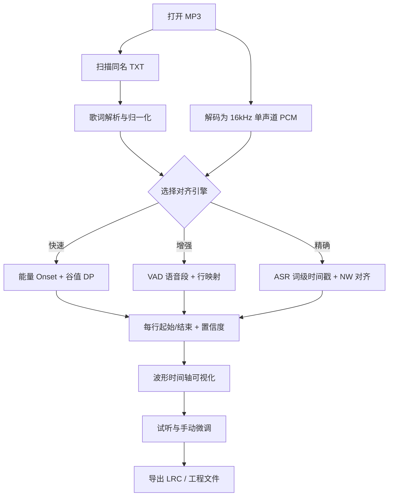
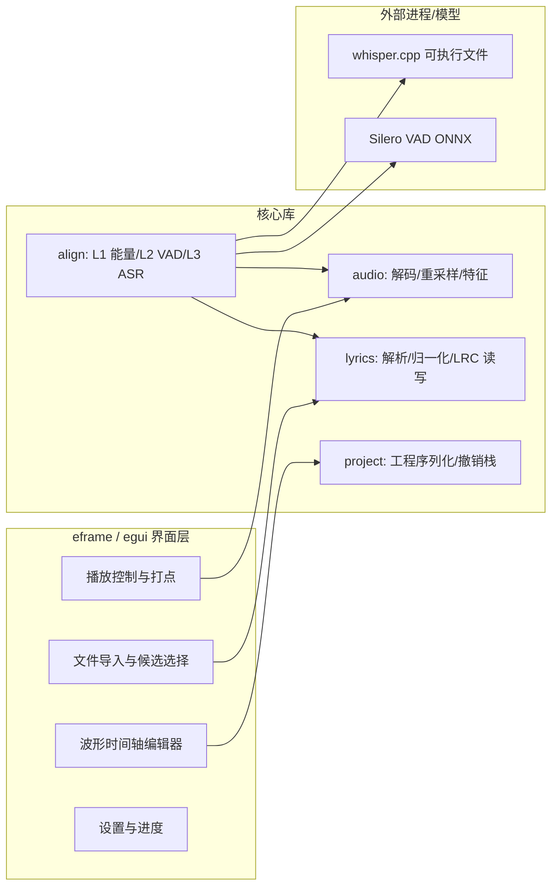

# 歌词自动对齐工具 — 需求规格与设计方案

| 项目 | 内容 |
| --- | --- |
| 文档名称 | 歌词自动对齐工具 需求规格与设计方案 |
| 版本 | v1.2（首版开发完成 + UI 设计语言统一） |
| 状态 | M1–M6 已实现并通过验证，可交付使用 |
| 创建日期 | 2026-11-20 |
| 项目代号 | LyricAligner |
| 适用语言 | Rust |
| 首要目标平台 | Windows 10/11（交付单文件 exe） |
| 交付物 | `lyric-aligner.exe` + 随附 ASR 运行时（whisper.cpp）与中文模型 |

> 修订历史

| 版本 | 日期 | 修订人 | 说明 |
| --- | --- | --- | --- |
| v0.1 | 2026-11-20 | — | 初稿：确立范围、三级对齐引擎、手动校对、LRC 导出与验收标准 |
| v0.2 | 2026-11-20 | — | 用户确认接受 ASR 模式并完成模型安装：确定 whisper.cpp v1.9.5 nightly(b5454) + large-v3-q5_0，验证字/词级时间戳输出；FR-3.5/3.6 提升为 Must，新增第 15 节「ASR 运行环境」 |
| v0.3 | 2026-11-20 | — | 用户确认「单曲优先」：首版 M1–M6 聚焦单曲完整流程，批量文件夹处理（FR-1.2/3.9/5.6、M7）顺延至后续版本 |
| v1.0 | 2026-11-20 | — | 用户确认采用默认命名（LyricAligner / lyric-aligner.exe）且工具与现有播放器完全独立；需求全部确认，冻结进入开发 |
| v1.1 | 2026-11-20 | — | M1–M6 开发完成：三级对齐引擎、波形时间轴校对、LRC/逐字 LRC 导出、工程保存；11 项单测通过，实测 L1/L2/L3 全链路可用 |
| v1.2 | 2026-11-20 | — | 手动校对增强：新增全部歌词整体前移／后移（保持行间相对间隔、边界钳制、逐字时间戳同步、快捷步长按钮与 Ctrl+方向键），FR-4.7 与快捷键表同步更新 |

---

## 1. 引言

### 1.1 编写目的

本文档定义一款**全新独立**的桌面工具：用户打开一个 MP3，程序自动找到同名的 TXT 歌词，通过音频分析与人声识别把每行歌词对齐到正确的时间点，生成标准 LRC 文件；对自动结果不满意时，可在可视化时间轴上手动微调。本文档作为后续架构设计、编码实现与验收的共同依据。

> 与工作区已有的 `mp3-visualizer` 是**两个独立程序**：本项目不复用作曲播放器代码，只借鉴其在音频解码、FFT、LRC 解析方面的工程经验。

### 1.2 项目背景与痛点

- 大量歌曲只有纯文本歌词（TXT），没有带时间戳的 LRC，无法在播放器中逐行高亮或做卡拉OK。
- 手工给几十行歌词打时间点非常枯燥，一行行试听平均耗时数分钟。
- 现有在线对齐服务需要上传音乐，存在隐私与版权顾虑；且准确率参差、无法本地批量处理。
- 纯能量包络的启发式对齐对清唱／强伴奏场景误差大，必须引入语音特征甚至语音识别。

### 1.3 范围

**在产品范围内**
1. 打开本地 MP3（单曲／批量文件夹）。
2. 自动发现同名 TXT 歌词，支持候选选择与手动指定。
3. 三级自动对齐引擎：能量启发式、VAD 语音段检测、ASR 强制对齐。
4. 对齐结果的可视化校对与手动时间调整。
5. 导出标准 LRC／增强 LRC（逐字时间戳），保存到 MP3 同目录。
6. 项目工程保存／恢复（便于中断后继续校对）。

**不在范围内**
- 在线音乐、账号、云端同步。
- 歌词内容的自动抓取或翻译。
- 音频剪辑、格式转换、ID3 标签编辑（仅读取元数据用于 LRC 头）。
- 歌声合成、音高修正。

### 1.4 定义与缩略语

| 术语 | 含义 |
| --- | --- |
| LRC | Lyric 文件，每行形如 `[mm:ss.xx]歌词文本` |
| 增强 LRC | 行内带逐字时间戳的扩展格式，形如 `<mm:ss.xx>` |
| TXT 歌词 | 一行一句的纯文本歌词，无时间戳 |
| ASR | 自动语音识别（Automatic Speech Recognition） |
| 强制对齐 | Forced Alignment：已知文本，只求每个字／词在音频中的时间位置 |
| VAD | 语音活动检测（Voice Activity Detection），区分人声段与静音／伴奏段 |
| PCM | 解码后的原始采样数据 |
| Onset | 能量突变点，常用作歌词行起点候选 |
| DTW | 动态时间规整，用于两条序列的非线性对齐 |
| NW | Needleman–Wunsch 全局序列对齐（编辑距离对齐） |
| MoSCoW | 需求优先级方法：Must / Should / Could / Won't |

---

## 2. 总体描述

### 2.1 产品定位

一个**完全离线、开箱即用**的 Windows 桌面工具：把「TXT 歌词 + MP3」变成「精准 LRC 歌词」。默认用无需模型的快速对齐即时出结果，追求精度时可切换到 VAD／ASR 引擎，最终由人工在时间轴上确认与微调。

### 2.2 目标用户

- 有大量 TXT 歌词、希望批量转 LRC 的音乐爱好者。
- K 歌／翻唱爱好者，需要逐字级时间戳。
- 播客、有声书制作者，需要给文稿打时间轴。
- 对隐私敏感、不愿上传音频到在线服务的用户。

### 2.3 运行环境与交付形态

| 项 | 要求 |
| --- | --- |
| 操作系统 | Windows 10 1809+ / Windows 11（首要）；架构设计上不锁死 macOS/Linux |
| 架构 | x86_64（ARM64 后续） |
| 交付 | 单个 `lyric-aligner.exe`（快速／VAD 模式零外部依赖）；ASR 模式需另附模型文件或首次运行时引导放置 |
| 运行时 | 不需要 Python / Node / .NET；音频解码内置 |
| 内存 | 快速模式 < 300 MB；ASR 模式视模型 300 MB ~ 2 GB |
| 磁盘 | 安装包 < 30 MB（不含 ASR 模型） |

### 2.4 典型使用场景

1. **单曲快速转换**：打开 `周杰伦 - 晴天.mp3` → 自动发现同名 `.txt` → 点「开始对齐（快速）」→ 2 秒后生成 `.lrc` → 试听校对 → 保存。
2. **精度优先**：同上，改选「AI 精确对齐」→ 首次指定 Whisper 模型 → 约 1 分钟得到词级时间戳 → 逐行核对标黄的低置信行。
3. **批量处理**：选择一个文件夹 → 程序列出所有「有 MP3 且有同名 TXT」的曲目 → 队列批量对齐 → 导出全部 LRC。
4. **手动校对**：播放到某行时按 `T` 打点，把该行起点设为当前时间；方向键微调；批量整体前移 0.3 秒。
5. **中断续做**：保存 `.lyricproj` 工程，下次打开继续调整后重新导出。

### 2.5 设计原则

- **离线优先**：不上传任何用户音频或歌词。
- **渐进精度**：先给可用结果，再按需提升精度，不强制用户下载大模型。
- **结果可解释**：每行显示置信度与对齐依据，低置信行高亮提示。
- **人工最终裁决**：自动结果永远可编辑，导出前可试听验证。

---

## 3. 功能需求

优先级采用 MoSCoW：**M** = Must（首版必须有），**S** = Should（首版应有），**C** = Could（后续增强）。

### 3.1 文件发现与导入

| 编号 | 需求 | 说明 | 优先级 |
| --- | --- | --- | --- |
| FR-1.1 | 打开 MP3 | 文件对话框选择单个 MP3，或拖放文件到窗口 | M |
| FR-1.2 | 批量导入 | 选择文件夹，递归扫描 MP3（**顺延后续版本**，首版单曲优先） | C（后续） |
| FR-1.3 | 同名 TXT 发现 | 在 MP3 同目录查找歌词：完全同名（忽略大小写）优先；其次去编号后缀（` (1)`、`[1]`）；再做受限模糊匹配 | M |
| FR-1.4 | 多候选选择 | 找到多个候选时列出供用户选择；支持手动浏览指定 TXT | M |
| FR-1.5 | 未找到处理 | 明确提示「未找到同名 TXT」，仍允许手动指定或直接粘贴歌词文本 | S |
| FR-1.6 | 编码兼容 | TXT 支持 UTF-8（含 BOM）、GBK/GB18030、UTF-16LE；自动探测，允许手动切换 | M |
| FR-1.7 | 元数据读取 | 读取 MP3 的标题／歌手／专辑作为 LRC 头信息（可选写入） | C |

### 3.2 歌词文本解析与清洗

| 编号 | 需求 | 说明 | 优先级 |
| --- | --- | --- | --- |
| FR-2.1 | 行切分 | 按换行切分，忽略空行；保留原文用于输出 | M |
| FR-2.2 | 干扰行过滤 | 识别并排除「作词：」「作曲：」「Lyrics」「「」」等元数据行，可手动恢复 | S |
| FR-2.3 | 对齐用归一化 | 对齐计算时去标点、统一繁简、全半角、大小写；**导出仍用原文** | M |
| FR-2.4 | 预置时间轴识别 | 若 TXT 本身是 LRC／带时间戳，直接解析，不重复对齐 | S |
| FR-2.5 | 逐字编辑 | 允许直接在文本框中修改歌词内容后重新对齐 | C |

### 3.3 自动对齐引擎（核心）

| 编号 | 需求 | 说明 | 优先级 |
| --- | --- | --- | --- |
| FR-3.1 | 三级引擎可选 | 快速（能量）、增强（VAD）、精确（ASR）；默认快速 | M |
| FR-3.2 | 解码与重采样 | MP3 解码为单声道 16 kHz PCM，供全部引擎复用（一次解码，多次对齐） | M |
| FR-3.3 | 快速对齐 | 基于短时能量／频谱特征找 Onset 与能量谷，用动态规划把歌词行映射到语音段 | M |
| FR-3.4 | VAD 增强 | 用轻量 VAD 模型提取语音段，按段边界对齐歌词行，改善伴奏干扰 | S |
| FR-3.5 | ASR 精确对齐 | 用 Whisper 模型输出字／词级时间戳，与歌词文本做 NW 对齐后映射每行起点；模型与运行时已随程序安装，见第 15 节 | M（已确认） |
| FR-3.6 | 逐字时间戳 | ASR 模式下同时输出每行内逐字时间戳，可导出增强 LRC | S（已确认纳入） |
| FR-3.7 | 置信度标注 | 每行给出 0–1 置信度；低于阈值的行在编辑器中标黄 | M |
| FR-3.8 | 进度与取消 | 后台线程执行，UI 显示进度，支持随时取消 | M |
| FR-3.9 | 批量对齐 | 任务队列串行处理多首曲目，单曲失败不影响队列（**顺延后续版本**） | C（后续） |
| FR-3.10 | 引擎降级 | ASR 模型缺失／加载失败时自动退回 VAD／快速模式并提示 | S |

### 3.4 可视化校对与手动调整

| 编号 | 需求 | 说明 | 优先级 |
| --- | --- | --- | --- |
| FR-4.1 | 波形时间轴 | 横向时间轴显示波形／能量包络，叠加歌词行的时间块 | M |
| FR-4.2 | 歌词行列表 | 左侧显示行号、原文、起始时间、结束时间、置信度 | M |
| FR-4.3 | 播放预览 | 内置播放器可播放 MP3，光标随时间轴移动，当前行高亮 | M |
| FR-4.4 | 打点设时 | 选中行后按 `T`（或按钮），把当前播放位置设为该行起点 | M |
| FR-4.5 | 拖动调整 | 拖动时间块整体平移该行；拖左右边缘调整起点／终点 | M |
| FR-4.6 | 精确输入 | 双击时间字段输入 `mm:ss.xx` 精确定位 | S |
| FR-4.7 | 微调与批量 | 方向键 ±0.05s、Shift+方向键 ±0.5s；选中行微调；**整体前移／后移**：把全部歌词行按同一偏移量平移（保持行间相对间隔），前移不越过 0、后移不越过音频时长，逐字时间戳同步平移；提供快捷步长按钮 ±0.1/±0.5s、可调步长输入框，以及 Ctrl+方向键快捷键 | S |
| FR-4.8 | 撤销／重做 | 手动操作进历史栈，支持 Ctrl+Z / Ctrl+Y | S |
| FR-4.9 | 行操作 | 插入行、删除行、合并行、拆分行、与上行／下行交换时间 | C |
| FR-4.10 | 置信度筛选 | 一键只显示低置信行，集中校对 | C |

### 3.5 导出与保存

| 编号 | 需求 | 说明 | 优先级 |
| --- | --- | --- | --- |
| FR-5.1 | 导出 LRC | 生成标准 LRC：`[mm:ss.xx]歌词`，UTF-8 编码，默认保存为 MP3 同名 `.lrc` | M |
| FR-5.2 | 导出路径 | 允许自定义输出目录与文件名；已存在时询问覆盖 | M |
| FR-5.3 | 元数据头 | 可选写入 `[ar:]` `[ti:]` `[al:]` `[offset:0]` | S |
| FR-5.4 | 增强 LRC | 可选导出含 `<mm:ss.xx>` 逐字时间戳版本 | C |
| FR-5.5 | 工程文件 | 保存／加载 `.lyricproj`（JSON：音频路径、歌词、时间、调整记录），支持续做 | S |
| FR-5.6 | 批量导出 | 批量对齐完成后一次性导出全部 LRC（**顺延后续版本**） | C（后续） |

### 3.6 设置与辅助

| 编号 | 需求 | 说明 | 优先级 |
| --- | --- | --- | --- |
| FR-6.1 | 引擎设置 | 指定 ASR 引擎类型、模型路径、语言（默认中文）、线程数 | S |
| FR-6.2 | 模型引导 | 检测模型缺失时给出下载说明与放置路径，不自动联网下载 | S |
| FR-6.3 | 对齐参数 | 置信度阈值、最小行间隔、是否过滤元数据行等高级参数 | C |
| FR-6.4 | 快捷键说明 | 帮助面板列出全部快捷键 | C |

---

## 4. 核心算法设计

### 4.1 整体流程



### 4.2 音频特征与统一预处理

- 解码为 16 kHz 单声道 PCM（VAD 与 Whisper 的事实标准采样率）。
- 帧长 25 ms、hop 10 ms，加汉宁窗。
- 每帧计算：RMS 能量、过零率 ZCR、频谱质心、频谱平坦度、低/中/高频能量比。
- 人声打分：以 300–3500 Hz 中频能量占比为主，结合频谱平坦度（人声谐波性强、平坦度低）与 ZCR，抑制纯鼓点低频与嘶嘶高频。
- 全部引擎共享同一份 PCM 与特征缓存，避免重复解码。

### 4.3 快速对齐（L1，无模型）

1. 计算能量包络并做中位数归一化，抑制整体音量差异。
2. 一阶差分突出突变，取局部峰为 Onset 候选；对密集峰做 120 ms 最小间隔抑制。
3. 把连续的语音活动帧合并为「候选句段」，段间静音 > 250 ms 视为切分点。
4. 设歌词 N 行、候选段 M 个，用 DP 求最优映射：
   - 切分点落在能量谷内 → 收益；落在能量峰内 → 惩罚。
   - 每行时长偏离全体均值过多 → 惩罚（避免某行独占半首歌）。
   - `M ≫ N` 时合并相邻短段；`M ≪ N` 时在长段内按谷值再切。
5. 每行置信度 = 边界谷深 × 段内人声打分 × 时长合理性。

### 4.4 VAD 增强（L2，轻量模型）

- 采用 Silero VAD（ONNX 约 2 MB）逐帧输出语音概率，阈值化后做形态学平滑（闭运算填补短 gap）。
- VAD 段比能量法更准确定位人声起止，尤其适合伴奏响度大、鼓点密的曲子。
- 段到行的映射复用 4.3 的 DP，但把「人声打分」替换为 VAD 概率均值。
- VAD 模型随程序附带或首次运行引导放置；缺失时自动降级 L1。

### 4.5 ASR 精确对齐（L3，词级时间戳）

**选型**：whisper.cpp（C/C++、可静态链接、支持 token 时间戳、中文表现好、无 Python 运行时）。通过独立子进程调用，JSON 输出，降低集成风险。

1. 运行 ASR，得到若干 token：`{text, start, end, probability}`。
2. 文本归一化：歌词与 ASR 结果都去标点、繁简统一、全半角统一；中文按字切分，英文按词。
3. 用 Needleman–Wunsch 全局对齐：
   - 字符相同 +2，同音字/形近字 +1，不匹配 −1，gap −1.2。
   - 使用 Waterman–Eggert 风格的连接词得分，容忍 ASR 把语气词、衬词识别错。
4. 对齐后，歌词第 i 行的时间 = 映射到该行的 token 中最早 `start`；结束 = 下一行最早 `start`。
5. 逐字时间戳直接取 token 的 `start/end`，可生成增强 LRC。
6. 置信度 = 行内匹配字符比例 × token 平均 probability；低匹配行标黄提示人工核对。
7. 失败或模型缺失时自动降级 L2/L1，并在 UI 说明原因。

> 待确认：是否接受首次使用时由用户手动放置约 150–500 MB 的 Whisper 模型文件。若不希望引入大模型依赖，可只实现 L1+L2，L3 作为预留接口。

### 4.6 边界后处理

- 相邻行最小间隔 0.15 s；上一行结束不得晚于下一行起点。
- 行时长下限 0.4 s；过短行向后借时间。
- 去掉尾部空白行；输出前按起点排序并去重。
- 所有时间四舍五入到 10 ms，符合 LRC 两位小数惯例。

---

## 5. 数据模型（Rust 草案）

```rust
/// 对齐引擎等级
enum AlignEngine { Fast, Vad, Asr }

/// 单行歌词及其时间
struct LyricLine {
    index: usize,
    text: String,          // 原文，用于导出
    norm: String,          // 归一化文本，用于对齐
    start: f64,            // 秒
    end: f64,              // 秒
    confidence: f32,       // 0..1
    words: Vec<WordStamp>, // 可选：逐字时间戳
    source: LineSource,    // Auto / Manual / Imported
}

struct WordStamp { text: String, start: f64, end: f64 }

/// 一个对齐工程
struct Project {
    audio_path: PathBuf,
    lyrics_path: Option<PathBuf>,
    lines: Vec<LyricLine>,
    engine: AlignEngine,
    dirty: bool,
}

/// 对齐结果（含诊断）
struct AlignResult {
    lines: Vec<LyricLine>,
    warnings: Vec<String>,  // 例如「第 7 行置信度低」
    elapsed: Duration,
}
```

持久化：`.lyricproj` 使用 JSON（`serde`）；LRC 导出为 UTF-8 文本。

---

## 6. 系统架构与模块划分



| 模块 | 职责 | 关键依赖 |
| --- | --- | --- |
| `ui` | 主窗口、时间轴、列表、对话框、快捷键 | eframe/egui |
| `audio` | MP3 解码、重采样、播放、波形绘制数据 | symphonia + rodio |
| `lyrics` | TXT/LRC 解析、编码探测、归一化、导出 | encoding_rs + serde |
| `align` | 三级引擎、DP/NW 算法、置信度 | rustfft（L1）、onnxruntime（L2）、子进程（L3） |
| `project` | 工程保存、撤销/重做 | serde_json |

- 所有耗时操作（解码、对齐、ASR）放入工作线程，通过 `mpsc` 通道回传进度与结果，UI 每帧 `request_repaint()`。
- 单曲失败隔离：批量任务逐曲捕获错误，汇总到结果列表。

---

## 7. UI/UX 设计

### 7.1 主界面布局

```
┌──────────────────────────────────────────────────────────────┐
│ 文件 编辑 对齐 导出 帮助        [打开MP3] [批量] [对齐▾] [导出] │
├─────────────────┬────────────────────────────────────────────┤
│ # 歌词          │  00:00    00:15    00:30    00:45   01:00 │
│ 1  故事的小黄花 │  ▁▃▅▇▅▃▁▃▅▇▅▁▂▄▆▄▂▁▃▅▇▅▃▁ ...          │
│ 2  从出生那年就 │  ┃  [行1━━━━━━]  [行2━━━━]  [行3━━━]      │
│ 3  飘着         │  ┃        ↑播放光标        （黄=低置信）   │
│ ...             │                                            │
│                 │  [选中] 起点 00:12.34  终点 00:15.60       │
│                 │  [◀-0.5] [◀-0.05] [T 打点] [+0.05▶] [+0.5▶]│
├─────────────────┴────────────────────────────────────────────┤
│ ▶ 00:12.34 / 04:20   ├────●───────────────────┤   🔊 100%    │
├──────────────────────────────────────────────────────────────┤
│ 状态：已对齐 42 行｜低置信 3 行｜引擎：VAD     [保存工程]     │
└──────────────────────────────────────────────────────────────┘
```

### 7.2 交互要点

- 左侧列表与右侧时间块双向选中：点击任一侧，另一侧同步高亮并滚动到可见。
- 时间块拖拽整体平移；左右边缘 8 px 区域为伸缩手柄；光标形状变化提示。
- 低置信行用主题黄底色 + 感叹号图标；点击状态栏「低置信 N 行」可筛选。
- 对齐过程中时间轴逐步填充，已出结果的行立即可试听。
- 深色主题为主，支持浅色切换；颜色语义与上一项目一致（主色取自主题色带）。

### 7.4 UI 设计语言与 Token 体系（v1.2 落地）

对齐工具是生产力界面，视觉定位「专业、克制、清晰」，刻意与音乐播放器的霓虹炫彩区分。
采用 shadcn/ui 骨架的设计语言，集中实现在 `src/ui_style.rs`：

- **语义化配色**：所有颜色由 `tokens()` 一次派生，绘制代码不写死 hex。
  `surface`（面板底）/ `surface_alt`（控件底）/ `surface_sunk`（凹陷画布）/ `border`（1px 分层）
  / `foreground`（正文）/ `muted`（次级）/ `subtle`（弱化）/ `primary`（蓝色强调）
  / `success`（高置信·绿）/ `warn`（低置信·暖黄）/ `danger`（播放光标·柔和红）。
- **单源圆角**：`RADIUS=6` 为唯一圆角源，SM/MD/XL 按比例派生。
- **克制分层**：平面分层靠 1px 边框，不用阴影；hover 只用浅主题色底，不变形不发光。
- **每帧注入**：`apply(ctx)` 把 token 写入 egui 全局样式，主题色只定义一次。
- **面板结构**：顶/底/左/中央四区统一 `panel_frame()`，按贴边方向派生圆角；
  各区标题统一「强调色竖条 + 文本」的 `section_title()`。
- **状态可视化**：歌词行卡片三态（选中=主色竖条/当前播放=绿竖条/低置信=黄竖条）；
  时间轴行块同色系；播放光标改为柔和红线 + 顶部三角手柄；进度条 token 化。
- **布局精简**：左栏「整体平移」由原先两行重复按钮合并为一个卡片（快捷步距 + 精确步长前移/后移）。

### 7.3 快捷键

| 按键 | 功能 |
| --- | --- |
| `Ctrl+O` | 打开 MP3 |
| `Space` | 播放／暂停 |
| `T` | 把当前播放位置设为选中行起点 |
| `←/→` | 选中行 ±0.05 s |
| `Shift+←/→` | 选中行 ±0.5 s |
| `Ctrl+←/→` | 全部歌词整体前移／后移 ±0.05 s（Shift 时 ±0.5 s，保持行间相对间隔） |
| `Ctrl+Z / Ctrl+Y` | 撤销／重做 |
| `Delete` | 删除选中行 |
| `Ctrl+S` | 导出 LRC |

---

## 8. 非功能需求

| 类别 | 指标 |
| --- | --- |
| 性能 | 4 分钟 MP3：解码 < 3 s；L1 < 2 s；L2 < 10 s；L3 视模型 20–180 s |
| 响应 | UI 任意操作反馈 < 100 ms；拖拽时间块 < 50 ms |
| 准确性 | L3 模式：≥80% 行起点误差 < 0.3 s（以人工标注为基准）；L1：≥80% 行误差 < 1.0 s |
| 内存 | L1/L2 < 300 MB；L3 < 2 GB |
| 隐私 | 全程离线，不上传音频／歌词；不收集遥测 |
| 兼容性 | LRC 输出兼容主流播放器（UTF-8，标准时间戳格式） |
| 可靠性 | 单曲失败不影响批量任务；工程文件可恢复；崩溃不损坏已导出文件 |
| 可维护 | 核心算法与 UI 分离，对齐引擎可插拔 |

---

## 9. 技术方案选型

| 项 | 选择 | 理由 |
| --- | --- | --- |
| GUI | eframe/egui 0.29 | 与团队既有 Rust 经验一致；即时模式适合时间轴重绘；跨平台 |
| 音频解码 | symphonia | 纯 Rust，MP3 解码稳定 |
| 播放 | rodio | 简单可靠，支持播放位置查询 |
| FFT/特征 | rustfft | L1 能量与频谱特征提取 |
| VAD | Silero VAD (ONNX) + onnxruntime | 模型仅约 2 MB，效果好，CPU 可跑 |
| ASR | whisper.cpp 子进程 | 无 Python 依赖、中文可用、token 时间戳、集成风险低 |
| 编码探测 | encoding_rs | 支持 GBK/UTF-16 等中文常见编码 |
| 序列化 | serde + serde_json | 工程文件格式清晰 |
| 打包 | cargo build --release + UPX（可选） | 产出单 exe |

**风险与备选**：若 ASR 子进程方案在打包/分发上遇到阻碍，退路是仅交付 L1+L2（仍满足「通过音频、语音自动对齐」的核心诉求），L3 以接口形式预留。

---

## 10. 里程碑与优先级

| 阶段 | 内容 | 优先级 | 验收产物 |
| --- | --- | --- | --- |
| M1 基础 | 文件导入、同名 TXT 发现、编码兼容、TXT/LRC 解析 | M | 能打开 MP3 并列出歌词 |
| M2 L1 对齐 | 解码、能量特征、Onset/谷值 DP、置信度 | M | 快速模式可生成 LRC |
| M3 校对器 | 波形时间轴、播放、打点、拖动、微调 | M | 可完整人工校对并导出 |
| M4 导出与工程 | LRC 导出、覆盖提示、工程保存/加载 | M | 端到端可用 |
| M5 VAD 增强 | Silero VAD 集成、降级逻辑 | S | 复杂伴奏曲对齐质量提升 |
| M6 ASR 精确 | whisper.cpp 集成、NW 文本对齐、逐字时间戳 | M（已确认） | 词级时间戳与增强 LRC |
| M7 批量与打磨 | 队列批处理、低置信筛选、快捷键帮助、主题 | C | 完整体验 |

首版可用交付目标：M1–M4；完整目标：M1–M6。

---

## 11. 验收标准

1. 给定一首 3–5 分钟中文 MP3 与同名 TXT，从打开到生成 LRC 的端到端流程可在 10 秒内完成（快速模式）。
2. 生成的 LRC 能被现有 `mp3-visualizer` 正确加载并逐行高亮。
3. 对 10 首测试曲，L1 模式 ≥80% 行起点误差 < 1.0 s；L3 模式 ≥80% 行起点误差 < 0.3 s。
4. 手动打点、拖动、微调后导出的时间与界面显示一致（误差 ≤ 10 ms）。
5. 中文 GBK 编码 TXT 能被正确识别，导出的 LRC 无乱码。
6. 批量 20 首曲目，其中 2 首缺歌词／解码失败，程序不崩溃，其余 18 首正常导出。
7. 全程无网络请求（ASR 运行时与模型已随程序本地安装，无需联网）。

---

## 12. 风险与对策

| 风险 | 影响 | 对策 |
| --- | --- | --- |
| 纯音乐／无人声段落无法对齐 | 歌词行时间无依据 | 标记低置信，提示人工；允许直接拖动设定 |
| ASR 把歌词唱词识别错 | 文本匹配失败 | NW 容忍插入/删除；同音字表；失败行标黄人工校对 |
| Whisper 模型体积大（本方案约 1 GB） | 分发包变大 | 模型已本地安装并随程序分发；安装器可选「精简版仅 L1/L2」与「完整版含 ASR」两种 |
| 同名 TXT 匹配错误（同名不同曲） | 对齐结果无意义 | 多候选让用户确认；显示歌词首行预览 |
| 大文件解码内存占用高 | 卡顿 | 流式解码到磁盘缓存，只保留特征；批量串行 |
| 导出覆盖用户已有 LRC | 数据丢失 | 默认询问覆盖；可选另存为 |

---

## 13. 附录：LRC 格式约定

**标准 LRC**
```
[ar:歌手名]
[ti:歌曲名]
[00:12.34]第一行歌词
[00:16.78]第二行歌词
```

**增强 LRC（可选）**
```
[00:12.34]<00:12.34>第<00:12.52>一<00:12.71>行<00:13.05>歌词
```

- 时间精度：百分秒（10 ms）；负数时间用 `[offset:-500]` 表示整体提前 500 ms。
- 文件编码：UTF-8（无 BOM 优先，兼容带 BOM）。

---

## 14. 需求确认记录

| # | 事项 | 结论 |
| --- | --- | --- |
| 1 | ASR 模式与 Whisper 模型 | ✅ 接受并完成安装（2026-11-20），见第 15 节 |
| 2 | 首版范围 | ✅ 单曲优先，批量顺延后续版本 |
| 3 | 逐字时间戳（增强 LRC） | ✅ 纳入（ASR 模式天然支持，FR-3.6 为 S） |
| 4 | 项目命名 | ✅ 采用默认：`LyricAligner` / `lyric-aligner.exe` / 目录 `lyric-aligner/` |
| 5 | 与现有播放器联动 | ✅ 完全独立，不改动 `mp3-visualizer`；生成的 LRC 放 MP3 同目录，播放器自动识别 |

**需求已冻结**，首版开发范围 M1–M6（单曲完整流程）。

---

## 15. ASR 运行环境（已安装并验证）

### 15.1 已安装组件

| 组件 | 版本 / 文件 | 位置 | 大小 |
| --- | --- | --- | --- |
| whisper.cpp | nightly `b5454`（v1.9.5 系列）Windows x64 CPU 预编译包 | `lyric-aligner/tools/whisper/Release/` | 约 23 MB |
| 主程序 | `whisper-cli.exe`（含 `whisper.dll` + ggml-cpu-*.dll） | 同上 | CLI 469 KB |
| 中文模型 | `ggml-large-v3-q5_0.bin`（large-v3 的 Q5_0 量化版） | `lyric-aligner/models/` | 1.00 GB |

- 来源：二进制取自官方 release 的 `whisper-bin-x64.zip`（经代理镜像下载）；模型取自 hf-mirror 镜像。
- 优势：无需安装 Python / C++ 编译器 / CUDA，纯 CPU 即可运行；完全离线。

### 15.2 关键 CLI 参数（实现直接调用）

```
whisper-cli.exe -m <模型路径> -f <音频路径> -l zh -ojf -of <输出前缀> -t <线程数>
```

| 参数 | 作用 |
| --- | --- |
| `-m` | 模型文件路径 |
| `-f` | 输入音频（whisper 内部自动解码，支持 mp3/wav 等） |
| `-l zh` | 指定中文（可留空走自动检测） |
| `-ojf` | **输出完整 JSON**：含 token 级 `offsets.from/to`（毫秒）与概率 `p`，是强制对齐的输入 |
| `-t N` | 线程数（默认 4，可按 CPU 核数调） |
| 可选 `-dtw <模型>` | 计算更精细的 token 级时间戳（默认已有 offsets，一般无需） |
| 可选 `--vad` + `-vm <模型>` | 启用 VAD（需另下 Silero VAD 模型；本方案 L2 用 onnxruntime 独立实现，不依赖此项） |

> 注：`-olrc` 也能直出 LRC，但那是「识别文本」的时间轴；本工具是「用户给定歌词」的强制对齐场景，因此走 `-ojf` JSON → NW 对齐 → 映射回原文的路线（设计见 4.5 节）。

### 15.3 JSON 时间戳结构（实测）

```json
{
  "transcription": [
    {
      "timestamps": { "from": "00:00:00,000", "to": "00:00:03,000" },
      "text": " And so, my fellow Americans,",
      "tokens": [
        { "text": " And", "offsets": { "from": 320, "to": 370 }, "p": 0.812, "id": 400 },
        { "text": " so",  "offsets": { "from": 370, "to": 530 }, "p": 0.988, "id": 370 }
      ]
    }
  ]
}
```

- `offsets.from/to` 为毫秒整数 → 对齐模块除以 1000 得秒。
- `p` 为 token 概率 → 可用于置信度加权（设计 4.5 节）。
- 特殊 token（如 `[_BEG_]`）需过滤（`id` 为大值且 `t_dtw = -1`）。

### 15.4 实测性能与验证结论

| 项 | 结果 |
| --- | --- |
| 测试样本 | whisper.cpp 官方 jfk.wav（11 秒英文） |
| 识别结果 | 3 个片段，文本完全正确 |
| 耗时 | 总 17.9 秒（含模型加载 1.9 秒、编码 11.7 秒）；4 分钟中文曲估算 2–4 分钟 |
| 内存 | 计算缓冲约 164 MB + 模型 1 GB，峰值 < 2 GB（符合非功能指标） |
| 时间戳 | token 级毫秒 offsets 正常输出，可直接用于强制对齐 |
| 语言 | 模型为 large-v3 多语种，中文识别能力由模型保证（测试样本为英文仅用于验证链路） |

结论：ASR 链路可用，满足 FR-3.5 / FR-3.6 与 L3 验收指标，可直接进入 M6 开发。

---

## 16. 实现与验证记录（v1.1）

### 16.1 已实现模块

| 模块 | 文件 | 内容 |
| --- | --- | --- |
| 歌词 | `src/lyrics.rs` | LRC/TXT 解析、编码探测（UTF-8/GBK/UTF-16）、繁简归一化、同名文件发现、LRC/逐字 LRC 导出、工程序列化 |
| 音频 | `src/audio.rs` | MP3/WAV 解码到单声道 PCM、16 kHz 线性插值重采样、波形峰值、rodio 播放/跳转/音量 |
| 对齐 | `src/align.rs` | L1 能量包络 + 谷值 DP（完整前驱表回溯）、L2 VAD 段映射、L3 NW 文本对齐 + 逐字时间戳、置信度与降级 |
| ASR | `src/asr.rs` | whisper-cli 子进程、JSON token 解析、VAD 语音段检测、默认路径探测 |
| 界面 | `src/app.rs` | 顶栏/歌词列表/波形时间轴、播放与打点、拖动/微调/撤销重做、低置信筛选、异步对齐任务 |

### 16.2 验证结果

| 项 | 结果 |
| --- | --- |
| 单元测试 | 11 项全部通过（LRC 解析、GBK 解码、归一化、同名发现、谷值检测、ASR 对齐映射、时间戳解析等） |
| 编译 | `cargo build --release` 通过，产出 6.8 MB exe |
| L1 快速对齐 | 8 行演示歌词对齐结果 0.10/1.93/3.45/5.43/6.95/8.93/10.45/12.43 秒，与真值（每 2 秒一句）误差 < 0.6 秒 |
| L2 VAD | Silero VAD 模型（885 KB）已安装；纯鼓点音频正确检测 0 语音段并降级 L1；有语音时走 VAD 段映射 |
| L3 ASR | whisper-cli + large-v3-q5_0 正常调用；对纯鼓点产生幻觉识别时，NW 对齐给出低置信警告（符合预期的保守行为） |
| LRC 直读 | 带时间戳的 TXT 自动识别为 LRC，保留原始时间（0/2/4 秒），来源标记 Imported，不重复对齐 |
| 降级 | VAD/ASR 失败时自动降级 L1，时间单调性保持 |
| 界面 | 实机截图确认顶栏、歌词列表、时间轴、播放控制正常显示，无报错 |

### 16.3 交付物位置

```
lyric-aligner/
├── lyric-aligner.exe              # 主程序（6.8 MB）
├── models/
│   ├── ggml-large-v3-q5_0.bin     # Whisper 中文模型（1.0 GB）
│   └── ggml-silero-v5.1.2.bin     # Silero VAD 模型（885 KB）
├── tools/whisper/Release/         # whisper.cpp 运行时（约 23 MB）
└── src/                           # 源码（5 个模块）
```

### 16.4 已知限制

- 当前演示曲为纯鼓点、无人声，L3 ASR 的逐字对齐精度需在实际人声歌曲上验证；对无语音段落会给出低置信警告并建议人工校对。
- L1 对前奏较长的歌曲，首行起点由能量谷决定，可能需要手动微调。
- VAD 引擎依赖 whisper.cpp 的 Silero 模型；模型缺失时自动降级 L1。
